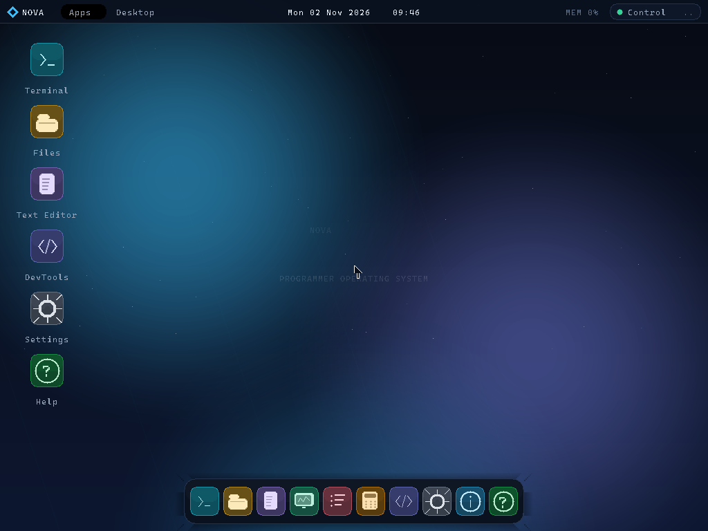

# Altitude OS 1.0.0 "Aurora"

A small, programmer-centric 32-bit x86 operating system built from scratch in C and NASM.
It boots from a 1.44 MiB floppy image, switches to a 32-bit VBE framebuffer, and presents
a complete desktop shell with draggable windows, a launcher, a dock, a control center, and a
suite of developer applications.



---

## Table of Contents

1. [Quick Start](#quick-start)  
2. [Building from Source](#building-from-source)  
3. [Running in QEMU](#running-in-qemu)  
4. [Project Structure](#project-structure)  
5. [Tech Stack](#tech-stack)  
6. [Directory Overview](#directory-overview)  
7. [Available Make Targets](#available-make-targets)  
8. [Keyboard Shortcuts](#keyboard-shortcuts)  
9. [Limitations](#limitations)  
10. [Credits](#credits)

---

## Quick Start

### Windows (one click)

1. Make sure the **MSYS2 UCRT64 toolchain** and **QEMU** are installed.
2. Double‑click **`start.bat`** (or run `mingw32-make run` from the command line).

The script builds the image if needed, then opens QEMU in a resizable window.

| Shortcut | Action |
| --- | --- |
| `start.bat` | Resizable window (press `Ctrl+Alt+F` in QEMU to toggle fullscreen) |
| `start.bat fullscreen` | Boot straight into fullscreen |
| `start.bat native` | Window at the guest's native pixel size |

### Command line

```bat
mingw32-make all     ; Build build/os_image.bin
mingw32-make run     ; Boot in a resizable, scaled QEMU window
mingw32-make run-native   ; Boot at the native guest resolution
mingw32-make run-fullscreen ; Boot QEMU fullscreen
mingw32-make debug   ; Start QEMU paused with a GDB stub on tcp::1234
mingw32-make size    ; Show the kernel size budget
mingw32-make clean   ; Remove build output
mingw32-make font    ; Regenerate include/font8x16.h
```

At boot, a two‑second menu lets you choose the guest resolution:

| Key | Resolution |
| --- | --- |
| `1` | 1024 × 768 (default) |
| `2` | 1280 × 720 |
| `3` | 1280 × 1024 |
| `4` | 1920 × 1080 |

QEMU must have at least 128 MiB of RAM; the Makefile uses 256 MiB so the framebuffer,
wallpaper, back‑buffer, and 32 MiB kernel heap all fit comfortably.

---

## Building from Source

### Prerequisites (Windows)

- **MSYS2 UCRT64 toolchain** at `C:\msys64_new\ucrt64\bin` containing:
  - `nasm`
  - `gcc` (32‑bit capable)
  - `ld`, `objcopy`
  - `mingw32-make`
  - `qemu-system-x86_64` with the GTK display backend
- **PowerShell 5.1 or newer** for the `.ps1` helper scripts

If your toolchain lives elsewhere, update the tool variables at the top of the `Makefile`
and the `MAKE` variable in `start.bat`.

### Build commands

```bat
mingw32-make all       ; builds build/os_image.bin
mingw32-make font      ; regenerates include/font8x16.h from Cascadia Mono
```

The build pipeline:

1. **NASM** assembles `boot/boot.asm` → `build/boot.bin` (512 bytes)
2. **NASM** assembles `boot/stage2.asm` → `build/stage2.bin` (8 KiB, padded)
3. **GCC** compiles all `src/` and `src/*/` C files → object files in `build/`
4. **LD** links objects → `build/kernel.elf`
5. **OBJCOPY** extracts `build/kernel.bin`
6. **tools/build_image.ps1** concatenates boot + stage2 + kernel into a 1.44 MiB floppy image

The build deliberately fails if the kernel exceeds the 448 KiB budget, rather than
silently producing an unbootable image.

---

## Running in QEMU

```bat
mingw32-make run          ; resizable window, scaled to fit
mingw32-make run-native   ; native guest resolution
mingw32-make run-fullscreen ; fullscreen QEMU launch
```

The QEMU window can be resized at any time. In windowed mode, the guest display is
scaled to fit the window. Press `Ctrl+Alt+F` in QEMU to toggle fullscreen.

### Useful QEMU monitoring

- **Serial log:** QEMU writes COM1 output to `build/serial.log`. The kernel mirrors
  `klog()` messages there, including the boot banner, framebuffer details, E820 summary,
  driver init, and process spawns.
- **GDB stub:** `mingw32-make debug` starts QEMU paused with `-s -S`. Connect a 32‑bit‑aware
  GDB and load `build/kernel.elf`.
- **QEMU monitor:** add `-monitor tcp:127.0.0.1:55555,server,nowait` to inspect registers,
  memory, or take screenshots.

---

## Project Structure

```text
boot/           - Two-stage bootloader (boot.asm, stage2.asm)
include/        - Headers (config, bootinfo, font, gfx, drivers, GUI, apps, etc.)
src/            - All source code organised into subsystems
│   ├── arch/     - GDT/IDT, interrupt stubs, kernel entry
│   ├── drivers/  - Serial, timer, RTC, keyboard, mouse, PCI, CPU
│   ├── lib/      - Freestanding string/memory routines
│   ├── mm/       - Boundary‑tag heap allocator
│   ├── fs/       - Hierarchical VFS and generated /proc
│   ├── gui/      - Compositor, window manager, theme, widgets, desktop
│   └── apps/     - Terminal, Files, Editor, Calculator, Monitor, Proctool,
│                   DevTools, Settings, About, Help
tools/          - PS1 scripts (genfont, build_image, qemu_probe)
build/          - Generated objects, kernel, image, serial log
docs/           - Architecture and shell documentation (images)
start.bat       - One‑click build + QEMU launch (removed per GitHub repo cleanup)
Makefile        - Recursive build, image assembly, run targets
.gitignore      - Excludes build outputs and editor noise
```

---

## Tech Stack

| Layer | Technology |
| --- | --- |
| **Architecture** | 32‑bit x86, VBE 2.0, IA32 ABI |
| **Assembly** | NASM (bootloader, entry stub, IDT/PIC assembly) |
| **Systems Language** | C (freestanding, no standard library) |
| **Boot** | Two‑stage bootloader (512‑B stage‑1 + 8 KiB stage‑2) |
| **Memory Management** | Boundary‑tag heap allocator, fixed 32 MiB kernel heap at `0x04000000` |
| **Filesystem** | Hierarchical in‑memory VFS with `/proc` generated files |
| **Interrupts** | 8259 PIC remapped to `0x20‑0x2F`, 256‑gate IDT, PIT at 100 Hz |
| **Input** | PS/2 keyboard & IntelliMouse, scancode set 1, modifier tracking |
| **GUI** | Custom compositor with back‑buffer, wallpaper, round‑rect windows,
  dropdowns, buttons, toggles, and a dark premium theme |
| **Scheduler** | Simulation‑based: FCFS, Round‑Robin (quantum = 3), Priority, SJF |
| **Applications** | 10 native apps: Terminal, Files, Editor, Calculator, Monitor,
  Proctool, DevTools, Settings, About, Help |
| **Build System** | Makefile with `mingw32-make`, PS1 helper scripts |
| **Emulation** | QEMU system‑x86_64 with GTK display backend |
| **Target Platform** | 1.44 MiB floppy disk image |

---

## Directory Overview

### Root Level

| File / Folder | Description |
| --- | --- |
| `boot/` | Stage‑1 (512 B) and stage‑2 (8 KiB) bootloaders |
| `include/` | Shared headers for all subsystems |
| `src/` | All C/ASM source files organised by subsystem |
| `tools/` | PowerShell scripts for font generation, image assembly, QEMU probing |
| `build/` | Build output directory (generated, tracked in `.gitignore`) |
| `Makefile` | Recursive build pipeline, image assembly, run/debug targets |
| `README.md` | This file — comprehensive project documentation |
| `LICENSE` | MIT license |

### `include/`

Contains every header needed by the kernel, drivers, GUI, and applications. Key files:

- `types.h` — Fixed‑width integer types (`u8`, `u16`, `u32`, `size_t`, `uintptr_t`), `min/max/clamp` macros
- `config.h` — `NOVA_VERSION "Aurora"`, `NOVA_CODENAME`, memory map limits, resolution limits, timer frequency
- `bootinfo.h` — Definition of `boot_info_t` magic `0x4E4F5641`, `e820_entry_t`, and handoff structure fields
- `kernel.h` — Core types (`regs_t`, `boot_info_t`), function declarations (`serial_init`, `klog`, `gfx_init`, etc.)
- `gfx.h` — Graphics primitives: back‑buffer, wallpaper buffer, text rendering, present, blend, blit
- `theme.h` — Theme system, `g_settings` struct (`accent`, `wallpaper`, `animations`, `dock_magnify`, `show_fps`, `clock_seconds`)
- `settings.h` — Persisted settings (`accent`, `wallpaper`, `animations`, `dock_magnify`, `clock_seconds`)
- `window.h` — Window management API (`WM_TITLE_H`, `WM_TITLE_BTN`, `WM_RESIZE_GRIP`, traffic‑button geometry)
- `desktop.h` — Compositor main loop, desktop FPS, cursor, toasts
- `apps.h` — Application registry, `app_id_t` enum, `app_info_t` struct
- `syscall.h` — `INT 0x80` syscall enum and `sys_call` signature
- `keyboard.h` — Key event structure, modifier bits, key codes enum
- `keys.h` — Extended key codes and modifiers
- `memory.h` — Boundary‑tag allocator structures
- `vfs.h` — Virtual filesystem node API
- `syscall.h` — Syscall enumeration and dispatch signature
- `splash.h` — Splash screen function declarations
- `timer.h` — Timer tick management
- `rtc.h` — Real‑time clock read/write
- `pci.h` — PCI configuration space scanner
- `process.h` — PCB forward declarations, spawn/kill helpers
- `interrupts.h` — IDT and PIC prototypes
- `io.h` — Inline I/O primitives (`port_inb`, `port_outb`, etc.)
- `font8x16.h` — Rasterised 8×16 bitmap font (generated by `genfont.ps1`)

### `src/`

All source code organised into subsystems:

- `src/kernel/` — Kernel initialisation and core (`kernel.c`, `klog.c`, `panic.c`, `splash.c`, `syscall.c`, `system.c`)
- `src/arch/` — Architecture‑specific code (`idt.c`, `interrupts.asm`, `kernel_entry.asm`, `cpu.c`)
- `src/drivers/` — Hardware drivers (`serial.c`, `timer.c`, `rtc.c`, `pci.c`, `keyboard.c`, `mouse.c`, `cpu.c`)
- `src/lib/` — Freestanding utilities (`string.c`)
- `src/mm/` — Memory management (`memory.c` — boundary‑tag allocator)
- `src/fs/` — Virtual filesystem (`vfs.c`, `procfs.c`)
- `src/proc/` — Process and scheduler (`process.c`, `scheduler.c`)
- `src/gui/` — Graphical user interface (`gfx.c`, `theme.c`, `widgets.c`, `window.c`, `desktop.c`, `settings.c`)
- `src/apps/` — Ten applications (`apps.c`, `about.c`, `calculator.c`, `devtools.c`, `editor.c`, `files.c`, `help.c`, `monitor.c`, `proctool.c`, `settings.c`, `shell.c`, `terminal.c`)

### `tools/`

- `build_image.ps1` — Assembles the 1.44 MiB floppy image from `boot.bin`, `stage2.bin`, `kernel.bin`
- `genfont.ps1` — Rasterises Cascadia Mono (fallback Consolas, Courier New) into `include/font8x16.h`
- `qemu_probe.ps1` — Headless QEMU boot probe with optional key chords and PPM screenshot capture

### `build/`

Generated output (tracked in `.gitignore`):

- `boot.bin` — 512‑byte boot sector
- `stage2.bin` — 8 KiB stage‑2 bootloader (padded)
- `kernel.elf` — Linked ELF binary
- `kernel.bin` — Raw kernel binary
- `os_image.bin` — Final 1.44 MiB floppy image
- `serial.log` — Serial output from QEMU/kernel
- `font_preview.png` — Font rasterisation preview

### `docs/`

- `screenshot.png` — Render of the current desktop
- (Formerly `architecture.md`, `shell.md` — moved to the new root `README.md`)

---

## Available Make Targets

| Target | Action |
| --- | --- |
| `all` | Build `build/os_image.bin` (boot + stage2 + kernel) |
| `run` | Launch QEMU in a resizable window (scaled to fit) |
| `run-native` | Launch QEMU at the native guest resolution |
| `run-fullscreen` | Launch QEMU in fullscreen mode |
| `debug` | Start QEMU paused with a GDB stub on `tcp::1234` |
| `size` | Show the kernel size budget |
| `clean` | Remove all build output |
| `font` | Regenerate `include/font8x16.h` from the font source |

---

## Keyboard Shortcuts (in QEMU)

| Shortcut | Action |
| --- | --- |
| `Super` (Windows key) | Open or close the application launcher |
| `Super+E` | Open Files |
| `Super+T` | Open Terminal |
| `Super+S` | Open Settings |
| `Super+H` | Open Help |
| `Super+C` | Open the Control Center |
| `Super+D` | Show the desktop (minimize all windows) |
| `Ctrl+Alt+T` | Open Terminal |
| `Ctrl+Alt+E` | Open Files |
| `Ctrl+Alt+D` | Show the desktop |
| `Alt+Tab` | Cycle through windows |
| `F1` | Open the developer guide |
| `Esc` | Close an overlay or send Escape to the focused app |
| `Drag title bar` | Move a window |
| `Drag an edge or corner` | Resize a window |
| `Title‑bar buttons` | Minimize, maximize/restore, close |
| `Mouse wheel` | Scroll app content |
| `Right‑click desktop` | Open the desktop context menu |
| `Ctrl+Alt+F` | Toggle fullscreen in QEMU |

---

## Limitations

- 32‑bit protected mode only; no long mode.
- No paging or user mode; all code runs at ring 0 in one address space.
- The VFS is a RAM filesystem and does not persist across reboots (settings are saved to `/etc/nova.conf`).
- The scheduler is a simulation used by the Process Manager; applications are cooperative windows inside the single kernel address space.
- Networking, audio, USB, and disk drivers are not implemented.
- The font is bitmap‑only and covers printable ASCII (32–126).

These are deliberate boundaries for a compact, readable teaching kernel rather than missing scaffolding.

---

## Credits

Altitude OS is built with C, NASM, the System V i386 ABI, the VBE 2.0 specification,
the 8259 PIC, the 8254 PIT, and the PS/2 controller. The bitmap font is
generated from Cascadia Mono on Windows. QEMU provides the virtual hardware.

---

## License

This project is released under the **MIT License**. See the `LICENSE` file in the root directory for details.